<p align="center">
  <picture>
    <source media="(prefers-color-scheme: dark)" srcset=".github/readme/hero-dark.png">
    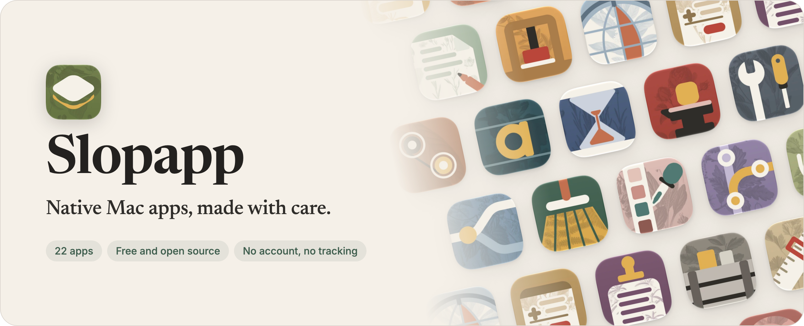
  </picture>
</p>

<p align="center">
  <a href="https://hunterunger.github.io/slopapp/"><b>Get Slopapp</b></a>
  &nbsp;·&nbsp;
  <a href="#the-apps">See the apps</a>
  &nbsp;·&nbsp;
  <a href="https://github.com/hunterunger/slopapp/issues/new/choose">Report a problem</a>
</p>

<p align="center">
  <a href="https://github.com/hunterunger/slopapp/actions/workflows/apps.yml"></a>
  
  
  
  
</p>

Slopapp is a growing collection of small Mac apps for the things you do every day: clipboard
history, screenshots, opening links in the right browser, dictation, a calm Git client, and
more. Each one does its job well, looks and works like it belongs on a Mac, and costs nothing.

One launcher installs them, keeps them up to date and removes them cleanly. Use one app or all
of them.

<p align="center">
  <picture>
    <source media="(prefers-color-scheme: dark)" srcset="web/public/shots/slopapp/hero-dark@1x.webp">
    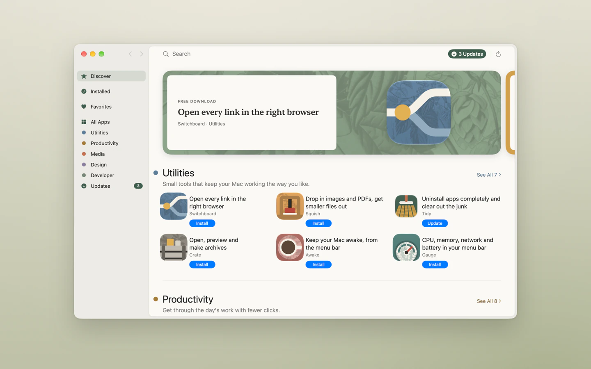
  </picture>
</p>

<table>
  <tr>
    <td width="50%" valign="top">
      <picture>
        <source media="(prefers-color-scheme: dark)" srcset="web/public/shots/slopapp/app-dark@1x.webp">
        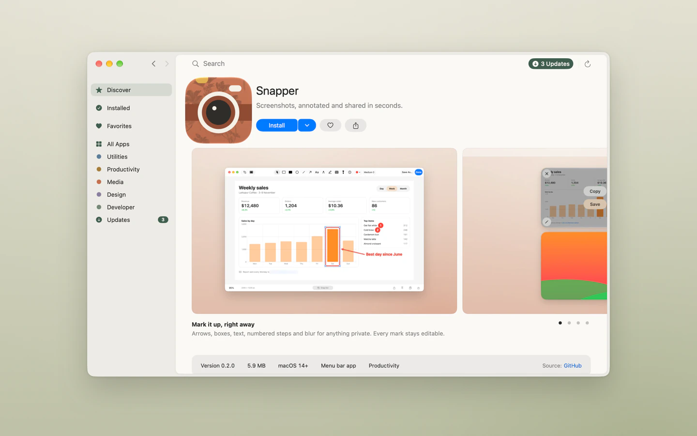
      </picture>
      <h3>See it before you install it</h3>
      Every app has its own page with screenshots, what's new and similar apps.
    </td>
    <td width="50%" valign="top">
      <picture>
        <source media="(prefers-color-scheme: dark)" srcset="web/public/shots/slopapp/updates-dark@1x.webp">
        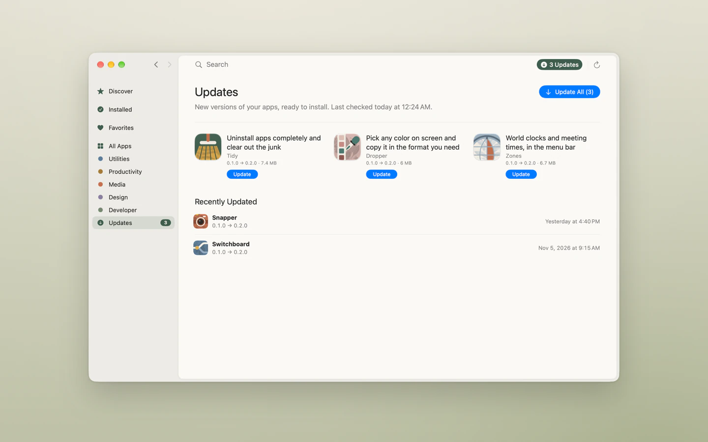
      </picture>
      <h3>Updates in one click</h3>
      The launcher checks for new versions in the background. Update one app, or all of them.
    </td>
  </tr>
</table>

## Why Slopapp

- **Native.** Written in Swift with SwiftUI and AppKit. Fast to open, light on memory and
  battery, with real Mac menus, shortcuts, Dark Mode and VoiceOver.
- **Private.** No accounts, no analytics, no tracking. Your data stays on your Mac. The few
  features that need the internet say so and are off until you turn them on.
- **Free, for good.** MIT licensed, no subscription, no trial, no upsell. Read the code, change
  it, build it yourself.
- **One family.** Every app follows the same [design system](docs/design-system.md), so once
  you know one, you know them all.

## See them in action

<table>
  <tr>
    <td width="50%" valign="top">
      <picture>
        <source media="(prefers-color-scheme: dark)" srcset="web/public/shots/snapper/hero-dark@1x.webp">
        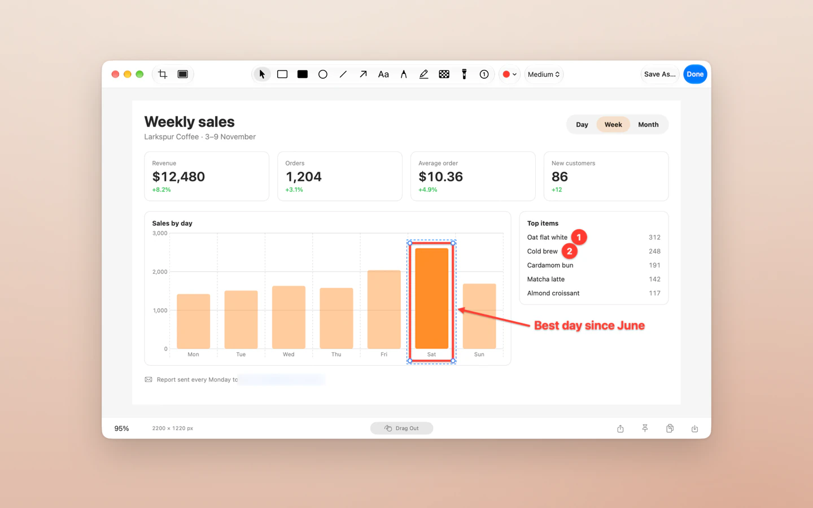
      </picture>
      <h3>Snapper</h3>
      Screenshots, annotated and shared in seconds. Arrows, boxes, text, numbered steps and
      blur, and every mark stays editable.
    </td>
    <td width="50%" valign="top">
      <picture>
        <source media="(prefers-color-scheme: dark)" srcset="web/public/shots/switchboard/hero-dark@1x.webp">
        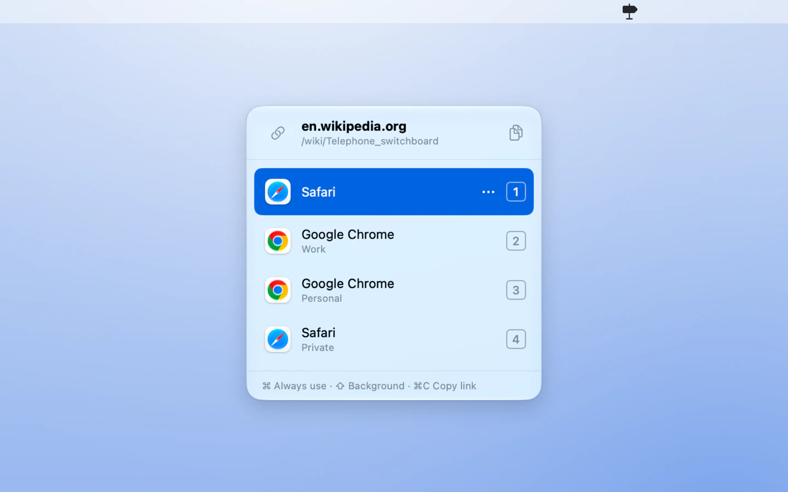
      </picture>
      <h3>Switchboard</h3>
      Open every link in the right browser. Click a link anywhere and choose a browser, a
      profile or a private window: press 1 to 9, or click.
    </td>
  </tr>
  <tr>
    <td width="50%" valign="top">
      <picture>
        <source media="(prefers-color-scheme: dark)" srcset="web/public/shots/snapper/card-dark@1x.webp">
        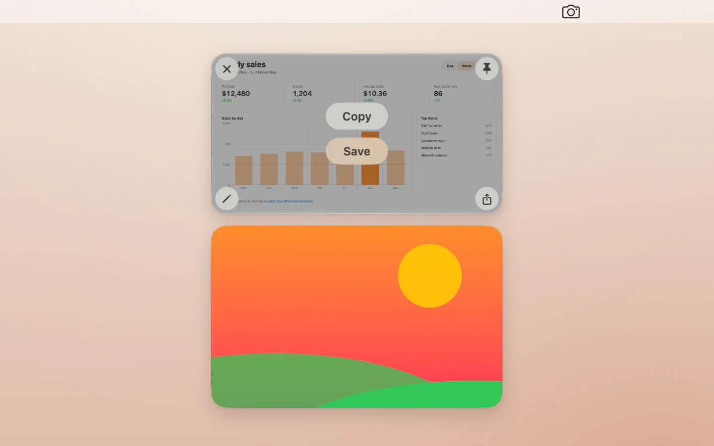
      </picture>
      <h3>Every capture, one click away</h3>
      Snapper's thumbnail waits in the corner: copy, save, annotate or pin it, or drag it
      straight into another app.
    </td>
    <td width="50%" valign="top">
      <picture>
        <source media="(prefers-color-scheme: dark)" srcset="web/public/shots/switchboard/rules-dark@1x.webp">
        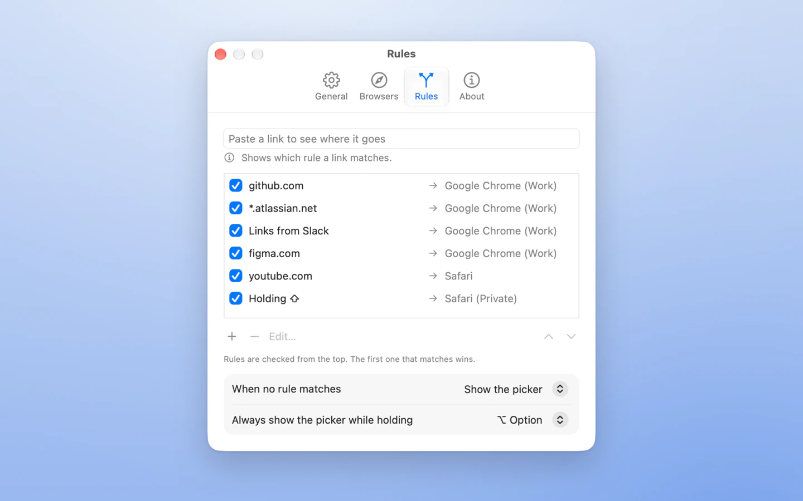
      </picture>
      <h3>Rules that pick for you</h3>
      Send work sites to your work profile and links from chat wherever you like. Set it once
      and Switchboard stops asking.
    </td>
  </tr>
</table>

## The apps

Alpha apps are new and still being tested; beta apps are ready for daily use. Each app's
folder has its own README.

<!-- apps:begin (generated by scripts/catalog.mjs) -->
### Utilities

| | App | Instead of | Status |
|:-:|---|---|---|
| 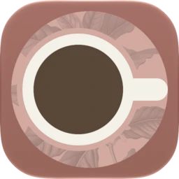 | **[Awake](apps/Awake)**<br>Keep your Mac awake, from the menu bar. | Lungo, Amphetamine | Alpha |
|  | **[Crate](apps/Crate)**<br>Open, preview and make archives. | Archiver | Beta |
| 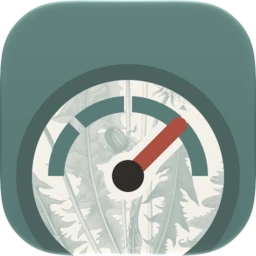 | **[Gauge](apps/Gauge)**<br>CPU, memory, network and battery in your menu bar. | iStat Menus | Alpha |
| 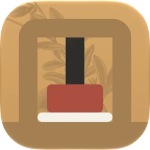 | **[Squish](apps/Squish)**<br>Drop in images and PDFs, get smaller files out. | Squash, PDF Squeezer | Alpha |
| 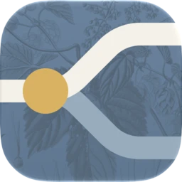 | **[Switchboard](apps/Switchboard)**<br>Open every link in the right browser. | OpenIn | Beta |
|  | **[Tidy](apps/Tidy)**<br>Uninstall apps completely and clear out the junk. | CleanMyMac | Beta |
|  | **[Triggers](apps/Triggers)**<br>Your own gestures, shortcuts and actions. | BetterTouchTool | Alpha |

### Productivity

| | App | Instead of | Status |
|:-:|---|---|---|
|  | **[Clips](apps/Clips)**<br>Clipboard history you can search. | Paste | Beta |
| 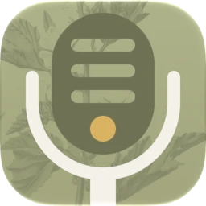 | **[Dictate](apps/Dictate)**<br>Talk, and your words appear wherever you're typing. | Superwhisper, Wispr Flow | Alpha |
| 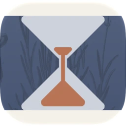 | **[Focus](apps/Focus)**<br>A calm focus timer that lives in your menu bar. | Session | Alpha |
|  | **[Paper](apps/Paper)**<br>Read, annotate and edit PDFs. | Nitro PDF Pro | Alpha |
|  | **[Shorthand](apps/Shorthand)**<br>Type a few letters, get the whole thing. | TextExpander, Rocket Typist | Alpha |
|  | **[Snapper](apps/Snapper)**<br>Screenshots, annotated and shared in seconds. | CleanShot X | Beta |
|  | **[Tally](apps/Tally)**<br>A notepad that does the math as you type. | Numi | Alpha |
|  | **[Zones](apps/Zones)**<br>World clocks and meeting times, in the menu bar. | World Clock Pro | Beta |

### Media

| | App | Instead of | Status |
|:-:|---|---|---|
| 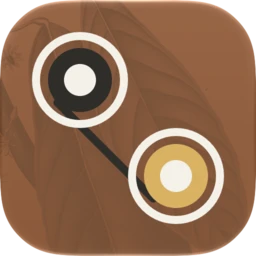 | **[Convert](apps/Convert)**<br>Drop in audio, video or images and convert them. | Permute | Alpha |

### Design

| | App | Instead of | Status |
|:-:|---|---|---|
|  | **[Dropper](apps/Dropper)**<br>Pick any color on screen and copy it in the format you need. | Sip | Beta |
|  | **[Iconsmith](apps/Iconsmith)**<br>Turn any image into app and folder icons. | Image2icon | Alpha |
| 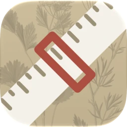 | **[Ruler](apps/Ruler)**<br>Measure anything on screen, to the pixel. | PixelSnap | Alpha |
|  | **[Specimen](apps/Specimen)**<br>Browse and compare your fonts. | Typeface | Alpha |

### Developer

| | App | Instead of | Status |
|:-:|---|---|---|
|  | **[Commit](apps/Commit)**<br>A calm Git client. | Gitfox | Alpha |
| 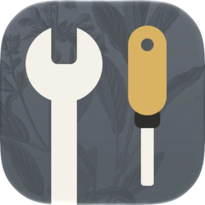 | **[Devkit](apps/Devkit)**<br>Offline developer tools: JSON, Base64, JWT, hashes and more. | DevUtils | Alpha |
<!-- apps:end -->

## Get started

1. **[Download the Slopapp launcher](https://github.com/hunterunger/slopapp/releases/latest/download/Slopapp.dmg)**
   (a disk image), open it and drag Slopapp to your Applications folder.
2. Open it, pick the apps you want and click **Install**. Updates arrive in the launcher.

Needs macOS 14 Sonoma or later (Dictate needs macOS 26.4). Each app can also be downloaded on
its own from [Releases](https://github.com/hunterunger/slopapp/releases).

> [!NOTE]
> The launcher is signed and notarized by Apple. Apps downloaded on their own from Releases
> aren't all notarized yet: if macOS stops one the first time you open it, open **System
> Settings > Privacy & Security**, scroll down, and click **Open Anyway**. You only need to do
> this once per app.

## Feedback

- **Something's wrong?** Choose **Report a Problem…** in the app (in its menu bar menu, or the
  Help menu). It opens a [GitHub issue](https://github.com/hunterunger/slopapp/issues/new/choose)
  with the app, version and macOS already filled in. Nothing is sent until you submit it.
- **An idea?** [Suggest an improvement](https://github.com/hunterunger/slopapp/issues/new?template=feature.yml)
  or [suggest a new app](https://github.com/hunterunger/slopapp/issues/new?template=new-app.yml).
- **A security problem?** Report it privately: see [SECURITY.md](SECURITY.md).

## Build from source

Needs macOS 14+ and Xcode 16+. No Xcode project: everything builds with SwiftPM and a few scripts.

```sh
scripts/run.sh Clips          # build and open an app
scripts/test.sh Clips         # its tests
scripts/check.sh              # lint, test, bundle and smoke-test every app (what CI runs)
cd web && pnpm i && pnpm dev  # the website
```

| Folder | What's in it |
|---|---|
| [`apps/`](apps) | One Swift package per app, plus [SlopKit](apps/SlopKit), the shared components |
| [`brand/`](brand) | Name, voice, colours, and the botanical app icon style |
| [`docs/`](docs) | [Design system](docs/design-system.md), [dev cycle](docs/dev-cycle.md), [build pipeline](docs/pipeline.md), per-app research |
| [`scripts/`](scripts) | Scaffold, test, bundle, smoke test, icons, screenshots |
| [`web/`](web) | The website (Next.js, static) |

Want to help? Start with [CONTRIBUTING.md](CONTRIBUTING.md). We study how other apps work,
never copy their names, icons, words or artwork.

## License

[MIT](LICENSE). Free to use, change and share.
